# Kit Maker: database schema

Postgres 16+ with `pgvector`. Models are defined as Ent schemas
(`internal/ent/schema`), and versioned migrations are generated with Atlas
(`migrations/`). River's own job tables live in the same database. IDs are
ULIDs. The prefixed ones (`bp_`, `prj_`, `sbx_`) are shown to users. One
deployment is one organisation, so there is no tenant column. Every blueprint,
block and integration has an **owner team** (`team_id`), and
`resource_grants` shares it with other teams at a role.

Arrows read "row → the row it references".

```mermaid
erDiagram
    %% ── Deployment, identity, audit ─────────────────────────
    %% identity
    auth_providers ||--o{ user_identities : "signs in"
    users ||--o{ user_identities : has
    users ||--o{ api_tokens : owns
    users ||--o{ mfa_factors : has
    auth_providers {
        ulid id PK
        string kind "local|oidc|saml|ldap"
        string preset "entra|okta|google|generic"
        string display_name
        bool enabled
        int position
        text config_encrypted "issuer, client id/secret ref, scopes, tenant, hd"
        jsonb allowed_domains
        string provisioning "jit|preprovisioned"
    }
    users {
        ulid id PK
        string email
        string display_name
        string password_hash "argon2id, local only"
        string status "active|suspended|deprovisioned"
        bool is_service_account
        timestamp last_login_at
    }
    user_identities {
        ulid id PK
        ulid user_id FK
        ulid provider_id FK
        string subject "IdP sub"
        string email
        jsonb last_groups "groups seen at last sign-in"
    }
    mfa_factors {
        ulid id PK
        ulid user_id FK
        string kind "totp|webauthn"
        text secret_or_credential_encrypted
    }
    api_tokens {
        ulid id PK
        ulid user_id FK "person or service account"
        string name
        string token_hash
        jsonb scopes
        timestamp expires_at
        timestamp last_used_at
    }

    %% teams & membership sources
    teams ||--o{ teams : "parent of"
    teams ||--o{ team_member_sources : "fed by"
    teams ||--o{ team_memberships : has
    users ||--o{ team_memberships : "member of"
    team_member_sources ||--o{ team_memberships : "produced"
    teams {
        ulid id PK
        ulid parent_team_id FK "nullable (nested teams)"
        string name
        string slug
    }
    team_member_sources {
        ulid id PK
        ulid team_id FK
        string kind "manual|claim_rule|scim|rest|directory_sync|callout"
        jsonb config "rule, group id, endpoint, schedule"
        string status
        timestamp last_synced_at
    }
    team_memberships {
        ulid id PK
        ulid team_id FK
        ulid user_id FK
        ulid role_id FK "team-scope role"
        ulid source_id FK
        bool pinned "manual add over external sources"
        bool excluded "local deny, wins over every source"
        timestamp expires_at "TTL for callout/claim rows"
    }
    membership_callouts {
        ulid id PK
        string url "must match allowlist"
        string auth "hmac|mtls"
        text secret_encrypted
        int max_ttl_seconds
        string failure_mode "fail_closed|last_known_good"
        int last_known_good_minutes
    }

    %% RBAC
    roles ||--o{ role_permissions : bundles
    roles ||--o{ role_assignments : "assigned via"
    roles ||--o{ team_memberships : "role in team"
    roles ||--o{ resource_grants : "granted as"
    roles {
        ulid id PK
        string key "e.g. maintainer, release-manager"
        string name
        string scope "deployment|team"
        bool built_in "presets are read-only, cloneable"
        text description
        int version
    }
    role_permissions {
        ulid role_id FK
        string permission "key from the Go registry, e.g. blueprint.promote"
    }
    role_assignments {
        ulid id PK
        ulid role_id FK "deployment-scope role"
        string principal_type "user|team"
        ulid principal_id "a team can hold a deployment role, e.g. Security → Auditor"
    }
    teams ||--o{ resource_grants : "granted"
    teams ||--o{ approval_policies : sets
    approval_policies ||--o{ approvals : governs
    resource_grants {
        ulid id PK
        string resource_type "blueprint|block|integration|..."
        ulid resource_id
        ulid grantee_team_id FK "or all"
        ulid role_id FK
    }
    approval_policies {
        ulid id PK
        string scope "global|collection|blueprint"
        ulid scope_id "collection or blueprint id; null for global"
        string action "widening|promote|publish_shared|guardrail_exception"
        int required_approvals
        bool author_can_approve
        string approvers "ai|human|ai_or_human|ai_and_human"
        ulid approver_role_id FK "for human approvals"
        ulid required_team_id FK "e.g. Security, nullable"
        string ai_max_risk "low|medium|high|none"
        bool allow_self_with_justification
        bool locked "lower levels may only tighten"
    }
    approvals {
        ulid id PK
        ulid policy_id FK
        string subject_type
        ulid subject_id
        ulid requested_by FK
        string approver_kind "ai|human"
        ulid decided_by FK "user; null for AI"
        ulid ai_suggestion_id FK "AI review verdict, findings, model, prompt version"
        string risk "low|medium|high"
        string status "pending|approved|changes_requested|escalated|rejected"
        text justification "required for self-approval"
    }
    integrations {
        ulid id PK
        string kind "registry|build_runner|git_host|ai|identity|storage"
        string driver "dockerhub|ghcr|ecr|acr|quay|zot|buildkit|build_cloud|gha|anthropic|bedrock|foundry|vertex|fake|github_app"
        text config_encrypted
        bool is_default
        timestamp verified_at
    }
    deployment_settings {
        string key PK
        text value_encrypted
    }
    audit_events {
        ulid id PK
        ulid actor_user_id FK
        string subject_type
        ulid subject_id
        string action
        jsonb data
        timestamp created_at
    }

    %% ── Block library ───────────────────────────────────────
    teams ||--o{ blocks : "owner team"
    blocks ||--o{ block_versions : "versioned as"
    blocks |o--o{ blocks : "forked from (inherits)"
    blocks {
        ulid id PK
        ulid team_id FK
        string type "network-rules|credential|install-hook|dockerfile|agent-context|..."
        string slug
        string name
        string visibility "private|team|public"
        ulid parent_block_id FK "fork parent, nullable"
        string parent_track "latest|pinned"
        ulid parent_pinned_version_id FK
        jsonb parent_overrides "patch ops on the parent"
        ulid current_version_id FK
        vector embedding "semantic search"
    }
    block_versions {
        ulid id PK
        ulid block_id FK
        int version
        jsonb payload "list items carry stable _k keys"
        string payload_hash
        string schema_version "vendored spec commit"
        text changelog
        string authored_by "user|ai"
        ulid accepted_by_user_id FK
        ulid ai_suggestion_id FK
    }

    %% ── Blueprint composition ──────────────────────────────────
    teams ||--o{ blueprints : "owner team"
    teams ||--o{ collections : "owner team"
    collections ||--o{ blueprints : groups
    blueprints ||--o{ slots : "outlined as"
    blueprints ||--o{ blueprint_includes : "includes"
    blueprint_includes }o--|| blueprints : "included"
    blueprint_includes }o--o| blueprint_versions : "pinned version"
    slots }o--o| blueprints : "origin (included)"
    slots |o--o| slots : "overrides"
    slots ||--o| block_links : "filled by"
    block_links }o--|| blocks : "links to"
    block_links }o--|| block_versions : "rebased on (base)"
    block_links }o--o| block_versions : "pinned to"
    collections {
        ulid id PK
        ulid team_id FK "owner team"
        string name
        string slug
    }
    blueprints {
        ulid id PK "bp_…"
        ulid team_id FK
        ulid collection_id FK "nullable, one collection per blueprint"
        string slug
        string display_name
        string kind "workload|mixin|set|environment"
        string image_repository "e.g. acme/sbx-kit-acme-shop"
        ulid registry_integration_id FK
        string network_preset
        bool registration_enabled
    }
    blueprint_includes {
        ulid id PK
        ulid blueprint_id FK "parent"
        ulid child_blueprint_id FK "included"
        string track "stable|latest|pinned"
        ulid pinned_version_id FK
        int position
    }
    slots {
        ulid id PK
        ulid blueprint_id FK
        ulid origin_blueprint_id FK "set when the slot comes from an included blueprint"
        ulid overrides_slot_id FK "included slot this one overrides"
        string key
        string section
        string state "blank|suggested|filled|optional"
        bool required
        int position
        bool optional_capability
        string group_name
    }
    block_links {
        ulid id PK
        ulid slot_id FK "unique"
        ulid block_id FK
        string track "latest|pinned"
        ulid pinned_version_id FK
        ulid base_version_id FK "overrides last rebased onto"
        jsonb overrides "set|unset|add|remove|replace by _k"
        string overrides_hash
        string rebase_state "clean|update_available|conflict"
        jsonb pending_rebase
    }

    %% ── Goals, checks, AI ───────────────────────────────────
    blueprints ||--|| goals : states
    blueprints ||--o{ checks : "derives"
    blueprints ||--o{ blueprint_revisions : "history"
    checks ||--o{ check_slot : ""
    slots ||--o{ check_slot : "satisfies"
    blueprints ||--o{ ai_threads : ""
    ai_threads ||--o{ ai_suggestions : contains
    ai_suggestions }o--o| slots : targets
    ai_suggestions }o--o| blocks : targets
    block_versions }o--o| ai_suggestions : "accepted from"
    teams ||--o{ ai_calls : "spends"
    blueprint_revisions {
        ulid id PK
        ulid blueprint_id FK
        int seq "1, 2, 3… per blueprint"
        ulid actor_user_id FK
        string action "baseline|create|edit|link|relink|unlink|add-slot|remove-slot|update|resync|goal|save-as-block|custom-block|restore"
        string slot_key "slot the change was about"
        text summary
        jsonb snapshot "goal, slots, links, overrides"
        text yaml "compiled YAML at that point"
        timestamp created_at
    }
    goals {
        ulid id PK
        ulid blueprint_id FK
        text statement
        jsonb sources "repo, kit yaml, dockerfile, sbx-scan"
    }
    checks {
        ulid id PK
        ulid blueprint_id FK
        string type "network|credential|tool|setup|agent|manual"
        jsonb spec "e.g. url + method"
        string expectation "reach|blocked|runs"
        string status "pass|fail|pending"
        string authored_by "user|ai"
    }
    check_slot {
        ulid check_id FK
        ulid slot_id FK
    }
    ai_calls {
        ulid id PK
        ulid team_id FK "budget owner"
        ulid user_id FK
        ulid blueprint_id FK
        string route "explain|fill|edit|plan|review|..."
        string provider "fake|anthropic|bedrock|vertex"
        string model "may be a fallback model"
        int input_tokens
        int output_tokens
        int cache_read_tokens
        int cache_write_tokens
        string status "ok|refused|error|over_budget"
        int duration_ms
        timestamp created_at
    }
    ai_threads {
        ulid id PK
        ulid blueprint_id FK
        ulid slot_id FK
        ulid block_id FK
    }
    ai_suggestions {
        ulid id PK
        ulid thread_id FK
        ulid blueprint_id FK
        ulid slot_id FK
        ulid block_id FK
        string kind "outline|fill|edit|checks|merge|review|explain|import|dedupe"
        text prompt
        jsonb proposal
        jsonb diff
        text rationale
        jsonb evidence
        bool widens
        string status "proposed|accepted|rejected|superseded"
        string model
        int input_tokens
        int output_tokens
        int cached_tokens
        ulid decided_by_user_id FK
    }

    %% ── Publish ─────────────────────────────────────────────
    blueprints ||--o{ blueprint_versions : "publishes"
    blueprint_versions ||--o{ blueprint_version_blocks : snapshots
    blueprint_version_blocks }o--|| block_versions : "exact version"
    blueprint_versions ||--o{ published_images : "pushed as"
    blueprint_versions ||--o{ builds : "built by"
    blueprints ||--o{ channels : ""
    channels }o--|| blueprint_versions : "points at"
    published_images }o--|| integrations : "registry"
    builds }o--|| integrations : "build runner"
    blueprint_versions {
        ulid id PK "shown as bp_…@vN"
        ulid blueprint_id FK
        int version "1, 2, 3… per blueprint"
        string digest
        text descriptor_yaml
        jsonb files
        jsonb permission_surface
        jsonb surface_diff
        bool widened
        jsonb checks_snapshot
        jsonb ai_review
        text release_notes
        ulid published_by_user_id FK
    }
    blueprint_version_blocks {
        ulid blueprint_version_id FK
        ulid block_version_id FK
        string overrides_hash
        int position
    }
    builds {
        ulid id PK
        ulid blueprint_version_id FK
        ulid integration_id FK
        string status "queued|running|succeeded|failed"
        string external_ref
        timestamp finished_at
    }
    published_images {
        ulid id PK
        ulid blueprint_version_id FK
        ulid integration_id FK
        string repository
        string digest
        string tags "vN, latest, stable"
        timestamp pushed_at
    }
    channels {
        ulid id PK
        ulid blueprint_id FK
        string name "latest|stable|custom"
        ulid blueprint_version_id FK
        ulid promoted_by_user_id FK
        timestamp promoted_at
    }

    %% ── Projects, downloads & running (DESIGN.md §2, §5) ───
    teams ||--o{ projects : "owner team"
    projects }o--|| blueprints : runs
    projects ||--o{ project_repos : "lives in"
    projects ||--o{ repo_references : ""
    projects ||--o{ downloads : ""
    blueprint_versions ||--o{ downloads : "downloaded as"
    users ||--o{ downloads : ""
    projects ||--o{ sandboxes : "work for"
    users ||--o{ sandboxes : "created by"
    sandboxes ||--o{ sandbox_network_activity : "reached or was refused"
    projects {
        ulid id PK "prj_…"
        ulid team_id FK
        string name
        text description
        ulid blueprint_id FK "one blueprint (it may include others)"
        string track "stable|latest|pinned"
        ulid pinned_version_id FK "nullable"
    }
    project_repos {
        ulid project_id FK
        string repo
        string path "where its sbxenv.yaml lives"
    }
    downloads {
        ulid id PK
        ulid blueprint_version_id FK
        ulid project_id FK "nullable"
        ulid user_id FK
        string kind "repo_reference|file|pull"
        timestamp created_at
    }
    sandbox_network_activity {
        ulid sandbox_id FK
        string host
        string decision "allowed|blocked"
        string matched_rule "nullable; sbx names it only for blocked"
        string reason "nullable"
        int count
        timestamp first_seen
        timestamp last_seen
    }
    blueprints ||--o{ repo_references : "referenced by"
    repo_references }o--o| blueprint_versions : "resolves to"
    repo_references }o--|| integrations : "git host"
    blueprint_versions ||--o{ sandboxes : runs
    repo_references ||--o{ sandboxes : "reported by"
    projects ||--o{ enrollment_tokens : ""
    users ||--o{ enrollment_tokens : ""
    repo_references {
        ulid id PK
        ulid project_id FK "nullable"
        ulid blueprint_id FK
        ulid integration_id FK
        string repo
        string path
        string ref_kind "channel|version|digest"
        string ref_value
        ulid resolved_version_id FK
        bool ci_bindings
        timestamp last_seen_at
        string source "git_scan|registration"
    }
    sandboxes {
        ulid id PK "sbx_…"
        ulid blueprint_version_id FK
        ulid project_id FK "nullable"
        ulid user_id FK "who created it (from the enrollment token)"
        ulid repo_reference_id FK
        string sandbox_name
        string resolved_digest
        string host_fingerprint_hash
        string sbx_version
        timestamp registered_at
        timestamp last_seen_at
        string status
    }
    enrollment_tokens {
        ulid id PK
        ulid project_id FK
        ulid user_id FK "per person per project"
        string token_hash
        timestamp revoked_at
    }
```

## How the pieces connect

- **Inheritance.** A `block_link` points at a `block` and records the
  `base_version_id` its `overrides` were last rebased onto. The blueprint uses base
  ⊕ overrides. A fork is a `block` whose `parent_block_id` is set, and it
  keeps inheriting the same way through `parent_overrides`.
- **Included blueprints.** `blueprint_includes` pulls another blueprint in at a channel
  or pinned version. Its slots show up with `origin_blueprint_id` set. A parent slot with
  `overrides_slot_id` replaces or patches the included slot. The outline's
  origin marker is derived as follows:

  | Condition | Origin |
  |---|---|
  | link, no overrides, own slot | Inherited |
  | link with overrides | Modified |
  | own slot, blueprint-only block | Custom |
  | `origin_blueprint_id` set, not overridden | From included blueprint |
  | `overrides_slot_id` set | Overrides included blueprint |

  Compile flattens included blueprints and overrides into one kit, because
  spec set composition has no override.
- **Reproducibility.** `blueprint_version_blocks` stores the exact
  `block_version` plus `overrides_hash` for every block in a version, so a
  `bp_…@vN` can always be rebuilt byte-for-byte.
- **Publishing.** A blueprint version becomes one or more `published_images`
  (one per registry push) and, if it has Dockerfile content, a `build`.
  `channels` (`latest`, `stable`) point at a blueprint version. Each image tag
  maps to one row.
- **From code to sandbox.** A `project` is the workload: a team, its repos and
  the one blueprint it runs. A `repo_reference` is one repo's `sbxenv.yaml`
  pointing at the blueprint by channel, version or digest. Downloading a
  version writes a `download` and issues the person an enrollment token for
  the project. When a sandbox registers with that token, it reports the
  reference and the digest it resolved, which creates a `sandbox` row linked
  to the `blueprint_version`, the `project`, the person and the
  `repo_reference`. `sandbox_network_activity` holds what sbx's policy log
  reported for it (DESIGN.md §5.1).
- **AI.** Every AI output is an `ai_suggestion` in a thread scoped to a
  blueprint, slot or block. Accepting one creates a `block_version` (or a check, or link
  overrides), which keeps `ai_suggestion_id` for authorship.
- **Identity.** One `user` can have several `user_identities` (local,
  Entra, Okta, Google, generic OIDC). Service accounts are users with
  `is_service_account`.
- **Teams.** A team's members are the union of `team_memberships` rows, each
  pointing to the `team_member_sources` row that produced it (manual, claim
  rule, SCIM, REST, directory sync or callout). `excluded` is a local deny
  that beats every source. Callout rows carry `expires_at` and are refreshed
  live.
- **RBAC.** An effective permission = deployment role ∪ (team role × owner
  team) ∪ `resource_grants`, minus exclusions. `approval_policies` exist at
  three scopes (global → collection → blueprint). The most specific wins per
  action, and `locked` stops lower scopes from loosening it. `approvals` records each
  decision: human or **AI reviewer** (verdict, risk, model and prompt version
  via its `ai_suggestion`), plus the typed justification for any
  self-approval.
- **Custom roles.** `roles` are permission sets (`role_permissions`) at
  deployment or team scope. Built-in presets are read-only rows. Team
  memberships, resource grants, approval policies and deployment
  `role_assignments` all point to a role. Permission keys come from the Go
  registry, so every feature is assignable.
- **Deployment.** `integrations` holds the per-deployment drivers (registry,
  build runner, git host, AI, identity, storage). Config is encrypted with
  the app key, or with a KMS envelope where the customer provides one.
